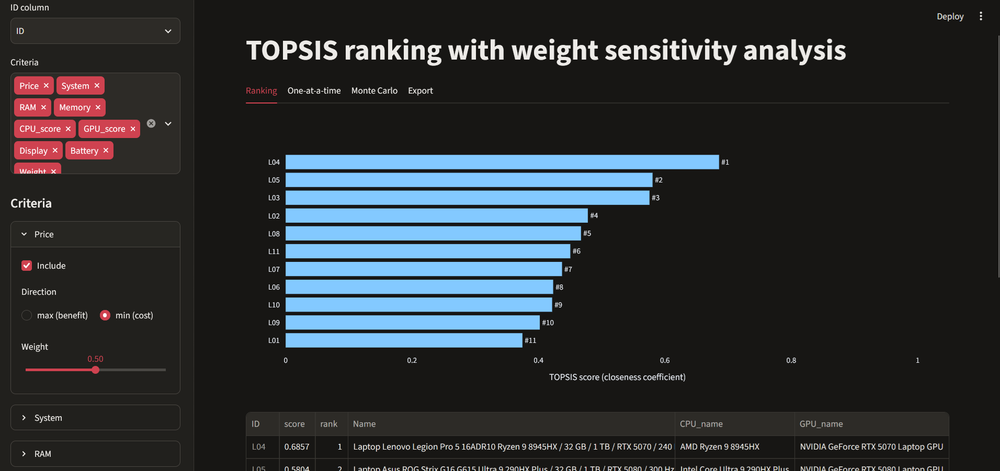
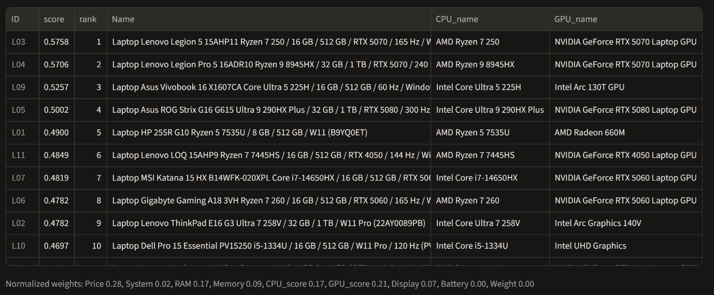
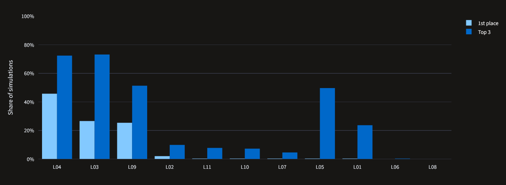
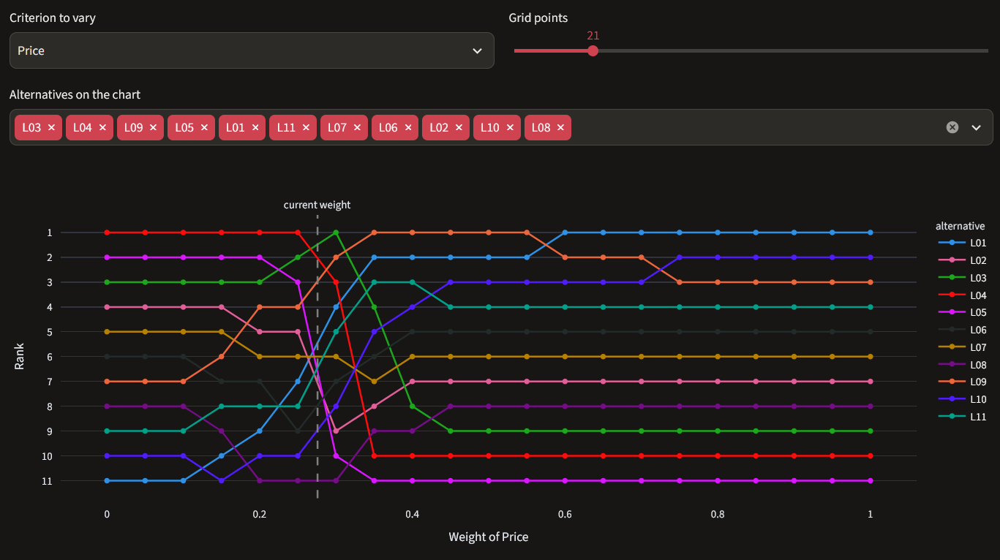

# TOPSIS laptop ranking with weight sensitivity analysis

A Streamlit app that ranks 11 laptops with the TOPSIS multi-criteria method and
checks how robust the ranking is to the choice of criterion weights.



## Goal

Choosing a laptop means trading off price, performance, weight, battery and more.
TOPSIS turns these criteria into a single ranking, but the result depends on the
weights, which are subjective. This project answers two questions:

1. Which laptop is best for a given set of weights?
2. How much would the weights have to change for a different laptop to win?

## Method

### TOPSIS

For a decision matrix with alternatives $i$ and criteria $j$:

1. **Vector normalization:** $r_{ij} = x_{ij} / \sqrt{\sum_i x_{ij}^2}$, which removes units (PLN, kg, GB).
2. **Weighting:** weights are normalized to sum to 1, then $v_{ij} = w_j \, r_{ij}$.
3. **Ideal and anti-ideal solutions:** for benefit criteria the ideal is the column
   maximum and the anti-ideal the minimum; for cost criteria the other way round.
4. **Distances:** Euclidean distances $d_i^+$ to the ideal and $d_i^-$ to the anti-ideal.
5. **Closeness coefficient:** $C_i = d_i^- / (d_i^+ + d_i^-) \in [0, 1]$; higher is better.
   Ties share a rank (competition ranking: 1, 1, 3).

### Sensitivity analysis

- **One-at-a-time:** the weight of one criterion goes from 0 to 1 while the other
  weights keep their proportions, so the weights always sum to 1. The app shows
  how each laptop's rank changes and at which weights the winner switches.
- **Monte Carlo:** weight vectors are sampled from a Dirichlet distribution with
  parameters $\alpha = c \cdot w$, where $w$ are the chosen weights and $c$ the
  concentration. The mean of the samples equals $w$; a larger $c$ keeps them
  closer to it. For each laptop the app reports the share of simulations in first
  place and in the top three, the mean rank and the full rank distribution.
  Results are reproducible for a given seed.

## Data

11 laptops, collected manually from [morele.net](https://www.morele.net) on 16.11.2026.
CPU and GPU benchmark scores come from PassMark ([cpubenchmark.net](https://www.cpubenchmark.net)).
Details, units and criterion directions: [data/README.md](data/README.md).

| Criterion | Unit | Direction |
|---|---|---|
| Price | PLN | cost |
| System | 0 = none, 1 = Windows 11 Home, 2 = Windows 11 Pro | benefit |
| RAM | GB | benefit |
| Memory (SSD) | GB | benefit |
| CPU_score | PassMark CPU Mark | benefit |
| GPU_score | PassMark G3D Mark | benefit |
| Display | refresh rate, Hz | benefit |
| Battery | capacity, Wh | benefit |
| Weight | kg | cost |

## How to run

Requires Python 3.11 or newer.

```bash
python -m venv .venv
# Windows (PowerShell): .venv\Scripts\Activate.ps1
# macOS / Linux:        source .venv/bin/activate
pip install -r requirements.txt

python src/clean_data.py      # raw data/laptops.csv -> data/laptops_clean.csv
streamlit run src/app.py      # opens the app at http://localhost:8501
pytest                        # run the tests
```

In the app you can use the example data or upload your own CSV (one row per
alternative, an ID column and numeric criteria). The sidebar sets each
criterion's direction and weight; unticking **Include** excludes a criterion
(weight 0). Tabs: **Ranking**, **One-at-a-time**, **Monte Carlo**, **Export**
(ranking as CSV).

## Project structure

```
topsis_sensitivity/
├── data/
│   ├── laptops.csv            raw data as collected (values with units)
│   ├── laptops_clean.csv      numeric data used by the app (generated)
│   └── README.md              sources, collection date, units
├── src/
│   ├── topsis.py              TOPSIS: validation, closeness coefficient, ranking
│   ├── sensitivity.py         one-at-a-time and Monte Carlo analyses, text summary
│   ├── clean_data.py          converts the raw CSV into numbers
│   ├── charts.py              Plotly figures
│   └── app.py                 Streamlit user interface
├── tests/
│   ├── test_topsis.py         hand-calculated cases, method properties, invalid input
│   └── test_sensitivity.py    hand-calculated cases, properties, reproducibility
├── requirements.txt
└── pytest.ini
```

`topsis.py` and `sensitivity.py` are pure functions without Streamlit, so they
can be tested and reused independently of the app. Both analyses use the same
vectorized TOPSIS core as the ranking itself.

## Testing

The tests combine hand-calculated examples (expected values computed by the
author) with properties the method must satisfy: invariance to column scale and
to weight scale, a dominant alternative scoring 1, identical alternatives sharing
a rank, a zero weight being equivalent to dropping the criterion, reproducible
Monte Carlo results for a fixed seed, and readable errors for invalid input.

## Results and conclusions

### Author's weights

| Criterion | Weight | Normalized |
|---|---|---|
| Price | 0.8 | 0.28 |
| System | 0.05 | 0.02 |
| RAM | 0.5 | 0.17 |
| Memory | 0.25 | 0.09 |
| CPU_score | 0.5 | 0.17 |
| GPU_score | 0.6 | 0.21 |
| Display | 0.2 | 0.07 |
| Battery | 0 | 0.00 |
| Weight | 0 | 0.00 |

### Ranking

With these weights two laptops stand out: **L03** (Lenovo Legion 5, score 0.576) and
**L04** (Lenovo Legion Pro 5, 0.571) are almost tied and clearly ahead of the next L09
(Asus Vivobook 16, 0.526). All remaining laptops score 0.50 or less.



### Stability

The ranking is not stable: small changes in the weights can change the top pick.
In the Monte Carlo simulation (n = 5000, concentration = 50, seed = 0) L03, despite being
first in the ranking, wins only about 26% of the simulations, while L04 wins about
46%. If robustness to the choice of weights matters most, L04 is the safer choice.
Both laptops reach the top three in roughly 72–73% of the simulations. L09 wins
about 25% of the time, practically as often as L03, however it is not as often in the top three.



Beyond the three expected leaders, L05 (in the top three in about half of the
simulations) and, to a lesser extent, L01 (about a quarter) also score highly,
although they almost never come first. Both are worth keeping on the shortlist
for the final decision. 

### Sensitivity to the Price weight (one-at-a-time)

Price has the largest weight, so it was varied from 0 to 1 while the other
weights kept their proportions (21 grid points, step 0.05). The winner changes
three times:

| Price weight | Winner |
|---|---|
| 0.00–0.25 | L04 |
| 0.30 | L03 |
| 0.35–0.55 | L09 |
| 0.60–1.00 | L01 |

The author's weight (0.28) lies right between the grid points where L04 and L03
swap places. This explains why the two are almost tied and why the Monte Carlo
winner changes so often: a small random change in the Price weight is enough to
cross the boundary.



L09 and L01 do surprisingly well given their clearly weaker hardware. The chart
shows that this is driven by price: with the Price weight set to 0, L01 ranks
last and L09 seventh, yet both climb steadily as the weight grows, and they take
first place from about 0.35 (L09) and 0.6 (L01). The high-performance laptops
behave the opposite way: L04 and L05 drop to 10th and 11th place once the Price
weight exceeds about 0.35.

**Conclusion:** the 0.005 difference between L03 and L04 is smaller than the
effect of weight uncertainty, and the choice depends mainly on how much price
matters. The analysis supports a shortlist (L04, L03, L09, then L05) rather than
a single winner: L04 if price is less important than in the author's weights,
L03 at the author's weights, and L09 or L01 if price dominates.

## Limitations

- **Weights are subjective.** The sensitivity analysis shows how much they matter
  but cannot choose them.
  By default all critera are set to have the same weight.
  This can be changed in the app.
- **Correlated criteria.** CPU and GPU scores tend to rise together, so performance
  can effectively be counted twice.
- **Rank reversal.** Adding or removing a laptop can change the order of two
  others, because the normalization and the ideal and anti-ideal solutions change.
- **Ordinal and proxy criteria.** `System` is an ordinal code (Pro > Home > none), not a measured quantity.
- **Snapshot data.** Prices reflect a single day; only weight uncertainty is
  analysed, not uncertainty in the data.
- **Small sample.** 11 laptops from one shop, not a market overview.

---

Code written with AI assistance; method validation, data and analysis by the author.
